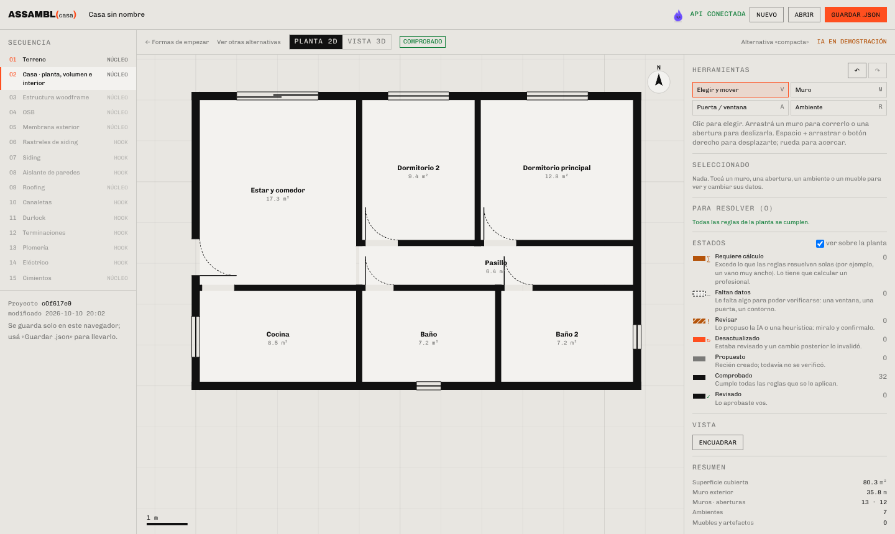
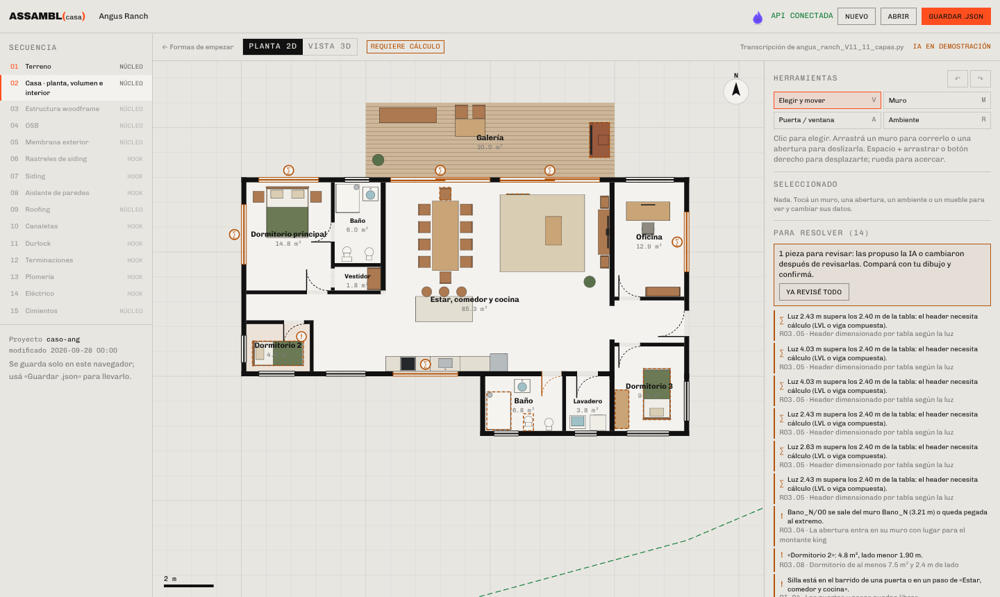
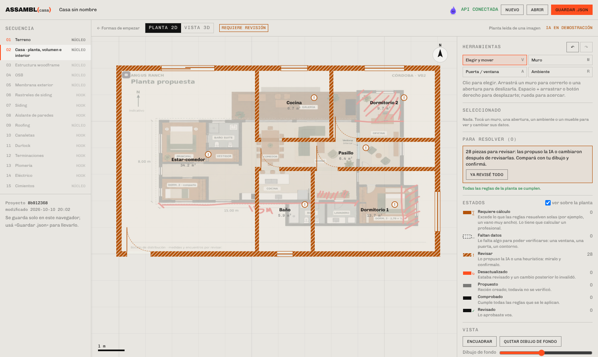

# Capa 03 · Casa — diseño del paso y del editor de planta

**Versión 0.3 · 10 de octubre de 2026 · Documento de trabajo**

Este documento fija cómo el usuario llega a la planta de su casa y cómo la edita. El código vive en
`frontend/src/pasos/casa/` (interfaz), `backend/assambl/capas/planta_base.py` (la planta base de Lumo),
`backend/assambl/capas/casa.py` (muros y aberturas a partir de rectángulos),
`backend/assambl/reglas/r03_planta.py` (reglas) y `backend/assambl/ia/` (Lumo, lectura de imágenes y proveedores).
Las capturas de `docs/paso_casa/` son el boceto: se decidió prototipar directamente en la aplicación, con
datos reales (Angus Ranch), en lugar de hacerlo en Figma. Así el prototipo que se prueba con usuarios es el
producto mismo.

| | |
| --- | --- |
|  Editor de planta |  Estados en Angus Ranch |
|  Planta leída de un bosquejo, a revisar | |

Las capturas del inicio y del recorrido con Lumo están pendientes: las anteriores mostraban un recorrido que
ya no existe.

## 1. Para quién

El usuario **no** es arquitecto ni modelador 3D. Es alguien entusiasmado con construir su casa en woodframe
que nunca usó un programa de dibujo. De ahí salen cinco principios que atraviesan el paso:

1. **Nunca un lienzo en blanco sin ayuda.** La primera pantalla ofrece maneras de empezar, no herramientas.
2. **Las reglas construyen.** Ni Lumo ni la IA que lee imágenes escriben muros: producen *rectángulos* (uno
   por ambiente) y la geometría la arma `capas/casa.py` con reglas deterministas. Es lo que pide MVP_01 §4.4:
   la interfaz y el asistente llaman las mismas operaciones y ninguno escribe geometría por su cuenta.
3. **Todo es un punto de partida.** Lo que sale de cualquier entrada se abre en el mismo editor.
4. **Se ve qué está verificado y qué no.** Cada pieza muestra su estado sobre el plano (§5).
5. **Español rioplatense, sin jerga.** Si hay un término técnico, se explica en una línea.

## 2. El recorrido

```
                    ┌──────────────────────────────┐
                    │      Empecemos tu casa       │  ← Inicio.tsx
                    └──────────────┬───────────────┘
              ┌────────────────────┼───────────────┬─────────────────┐
              ▼                    ▼               ▼                 ▼
       Diseñá con Lumo        Subí un bosquejo  Dibujar desde     Ver un ejemplo
       (camino principal)     (IA, imagen)      cero (básico)     (Angus Ranch)
              │                    │               │                 │
              ▼                    ▼               │                 │
      DisenarConLumo.tsx    ImportarImagen.tsx     │                 │
   tres decisiones · la     lectura + planta encima│                 │
   planta base se arma a    de la imagen · dudas   │                 │
   la vista y se explica    con opciones           │                 │
              │                    │               │                 │
              └────────────────────┴───────┬───────┴─────────────────┘
                                           ▼
                              Editor de planta 2D (EditorPlanta + PanelEditor)
                              verificación en vivo con R03 · deshacer · estados
                              Lumo siempre a mano: pedidos en palabras y «Resolver»
```

**Criterio:** primero un solo camino bien resuelto, después se complejiza. Lumo es ese camino. Antes había
una charla abierta que terminaba en tres plantas para elegir; se quitó porque las plantas no convencían y
elegir entre tres no ayudaba a quien no sabe de plantas.

### 2.1 Diseñá con Lumo

**Lumo** es la mascota de Assambl: una llama índigo con ojos y una sonrisa fija (`componentes/lumo/`; la
definición está en `lumo/lumo-final.html`). Sus estados acompañan el recorrido: saluda en el inicio, piensa
mientras se pide el turno, «ensambla» cuando cambia la planta, festeja cuando no falta nada, escucha mientras
el usuario escribe y se inquieta si algo falla. Respeta `prefers-reduced-motion`.

El recorrido son **tres decisiones, siempre las mismas y en el mismo orden** (`ia/lumo.py`):

| Decisión | Opciones | Qué cambia |
| --- | --- | --- |
| Dormitorios | 1 a 4 | Qué ambiente ocupa cada lugar y si la casa tiene ala de entrada |
| Cocina | Abierta o cerrada | Si es parte del estar o un ambiente propio |
| Tamaño | Compacta, cómoda o amplia | Las medidas; cada opción muestra los m² reales que saldrían |

- **Una pregunta por vez**, cada opción con su consecuencia en pocas palabras. Siempre se puede escribir en
  vez de elegir; lo escrito se lee por palabras clave.
- **La planta aparece con la primera respuesta.** Lo que falta decidir va con el valor más común (tres
  dormitorios, cocina abierta, tamaño cómodo) y se ve punteado en los controles hasta que el usuario lo elige.
- **Todo se puede cambiar.** Debajo de la planta hay un control por decisión; tocar otro valor rearma la casa.
- **La casa se explica.** Cuatro textos cortos dicen por qué quedó ordenada así.
- No usa un modelo de lenguaje: es inmediato, igual para todos y no depende de tener una clave de IA.
- Desde el editor, «Cambiar decisiones con Lumo» vuelve con las decisiones de la planta (se guardan en
  `casa.origen.decisiones`).

### 2.2 La planta base

`capas/planta_base.py` arma **una sola planta**, con un orden que se puede explicar. Ese orden sale de leer
cómo está resuelta Angus Ranch y quedarse con lo que la hace funcionar:

1. **Una barra alargada de este a oeste**, con el frente largo hacia el sol (norte en el hemisferio sur; en el
   norte la planta se espeja).
2. **Estar, comedor y cocina en el centro, de fachada a fachada.** No hay pasillos: el centro reparte hacia
   los dos extremos y ventila cruzado.
3. **La suite principal en un extremo**: dormitorio, vestidor y baño. Enfrente, otro ambiente; entre los dos,
   un rincón del estar al que dan sus puertas.
4. **La entrada en el otro extremo**, por un hall chico entre dos ambientes.
5. **Baño y lavadero en un anexo del lado frío**, pegados a la cocina: una sola zona de cañerías, y el frente
   del sol queda libre para vivir.

Las decisiones no cambian el esquema, cambian quién ocupa cada lugar:

| Dormitorios | Frente a la suite | Ala de entrada |
| --- | --- | --- |
| 1 | Escritorio | No hay: se entra por un costado del estar |
| 2 | Dormitorio 2 | No hay: se entra por un costado del estar |
| 3 | Dormitorio 2 | Dormitorio 3 y escritorio, con el hall entre los dos |
| 4 | Dormitorio 2 | Dormitorios 3 y 4, con el hall entre los dos |

Con cocina cerrada, la cocina es un ambiente alargado frente a la suite que avanza sobre el centro, con un
paso hacia el comedor; la franja crece para darle lugar. «Amplia» con tres dormitorios y cocina abierta mide
lo mismo que Angus Ranch.

El estar es **un solo ambiente** aunque no sea rectangular: toma el rincón frente a la suite y el hall de
entrada. Para eso los rectángulos llevan un `grupo`, y los que comparten grupo forman un solo contorno sin muro
entre ellos. Un rectángulo también puede pedir dónde va su puerta (`puerta`) o la entrada de la casa
(`acceso`); si no lo pide, el generador elige.

Las 48 variantes (dormitorios × cocina × tamaño × hemisferio) pasan todas las reglas R03 sin advertencias; lo
verifica `tests/test_casa.py`.

**Qué queda afuera por ahora:** superficie exacta, cantidad de baños (siempre el de la suite y uno general),
galería, garage y otros partidos. Las plantas son generosas (de 99 a 173 m²) porque heredan las proporciones
de Angus Ranch.

### 2.3 Subí un bosquejo o un plano

1. Se arrastra una imagen (PNG/JPG). El navegador la achica a 1600 px antes de enviarla.
2. Opcionales: **ancho total del frente** (para escalar si el dibujo no tiene cotas) y aclaraciones.
3. La IA devuelve ambientes como rectángulos en metros, **la escala que usó** (cotas del dibujo, medida del
   usuario o estimada), su **confianza**, advertencias y **preguntas con opciones** para lo ambiguo. Tocar una
   opción vuelve a interpretar con esa aclaración.
4. `normalizar_rectangulos()` alinea bordes casi coincidentes y lleva todo a la grilla de 5 cm; el generador
   arma muros, aberturas y ambientes.
5. La planta se muestra **encima de la imagen** para compararla, y en el editor la imagen queda de fondo
   (calco) con opacidad regulable.
6. **Todas las piezas nacen `pendiente_revision`.** El usuario corrige y confirma, pieza por pieza
   («✓ Revisado») o en bloque («Ya revisé todo»).

Un ambiente en L se lee como dos rectángulos «Estar (a)» y «Estar (b)»: forman un solo ambiente, sin muro
entre ellos.

### 2.4 Dibujo libre y ejemplo

- **Dibujar desde cero** abre el editor vacío con una indicación para empezar con la herramienta Muro.
- **Ver un ejemplo** carga `casos/angus_ranch.assambl.json` (el caso de regresión de V11). Sirve para
  mostrar el editor con una casa real y con estados no triviales: sus corredizas de 4 m «requieren cálculo» y
  el estar-comedor «faltan datos» porque V11 no lo delimita.

## 3. El editor de planta 2D

Lienzo SVG en metros, con X al este e Y al norte (convención de Angus Ranch). Muestra grilla de 1 m / 5 m,
norte, barra de escala, coordenadas del cursor, el lote de la capa 01 (línea verde) y el calco si lo hay.

| Herramienta | Tecla | Qué hace |
| --- | --- | --- |
| Elegir y mover | V | Clic elige. Arrastrar un muro lo corre en perpendicular y **arrastra lo conectado**: los extremos de los muros que apoyan contra él, los bordes de los ambientes y la posición de sus aberturas. Arrastrar una abertura la desliza por su muro sin dejarla pisar otra. |
| Muro | M | Clic en cada quiebre. **Siempre a 90°** (gana el eje con más recorrido). Imanes a extremos existentes, alineación con extremos a 10 px y grilla de 5/10/25 cm según el zoom. Muestra el largo mientras se dibuja. Al cerrar sobre un extremo termina la cadena; doble clic o Esc también. Se elige el sistema: exterior 45 × 140, interior portante o tabique 45 × 90. |
| Puerta / ventana | A | Se elige un ítem del **catálogo** (`catalogo/ar.json`, familia `aberturas`) y se hace clic sobre un muro. Una sombra muestra dónde queda y avisa «no entra» antes de hacer clic. |
| Ambiente | R | Se arrastra un rectángulo; al soltar se elige el ambiente y el foco va al nombre. |

Además: rueda para acercar, espacio + arrastrar o botón derecho para desplazarse, Supr para borrar, Esc para
soltar, Ctrl+Z / Ctrl+Shift+Z para deshacer y rehacer (80 pasos).

Arriba a la izquierda del lienzo está el interruptor **Cotas**: muestra las medidas exteriores de la casa
(una línea por cada lado de la huella), el ancho × fondo de cada ambiente y, al lado, los **m² cubiertos** y
la suma de los ambientes. Sirve para ver qué le hace a la superficie total agrandar un ambiente.

**Ambientes.** Doble clic sobre un ambiente lleva el cursor a su nombre. En sus propiedades, «Integrar con»
saca el muro que lo separa de un vecino y los une en un solo ambiente (aunque el resultado no sea
rectangular), y «Quitar etiqueta» le saca el nombre y deja el espacio con sus muros, para darle otro uso.

El panel derecho tiene las propiedades de lo elegido (sistema y largo del muro; catálogo, posición, ancho,
antepecho, dintel, bisagra y sentido de la puerta; nombre y uso del ambiente), la lista **«Para resolver»**
(cada ítem lleva a su pieza y la resalta al pasar el mouse), la leyenda de estados con cantidades y un resumen
(superficie cubierta, muro exterior, piezas).

Todas las ediciones son operaciones puras en `operaciones.ts` (`agregarMuro`, `moverMuro`,
`agregarAbertura`, `modificarAbertura`, `agregarAmbiente`, `marcarRevisado`…) que devuelven una casa nueva.
La huella se recalcula encadenando los muros exteriores. Lo que la casa trae de otras capas (cubiertas,
instalaciones, mobiliario) se conserva sin tocar.

### 3.1 Lumo en el editor

Arriba del panel derecho, siempre visible, está Lumo con un campo para escribirle (`LumoEditor.tsx`). Hace
dos cosas, con el mismo trato:

1. **Pedidos en palabras.** «Quiero ampliar este ambiente», «cambiá la entrada de lugar», «cocina abierta,
   integrada al living». Un modelo de lenguaje (`ia/lumo_editor.py`) traduce el pedido a **acciones de una
   lista cerrada**; no escribe muros ni coordenadas. «Este» es lo que esté elegido en la planta.
2. **«Resolver».** Cada ítem de «Para resolver» tiene un botón. Para lo que tiene una salida clara, Lumo
   actúa con reglas, sin IA (`resolver.ts`); lo que no, se lo pasa al modelo como cualquier otro pedido.

En los dos casos:

- **Lumo aplica el cambio y pide confirmación**: cuenta qué hizo y deja «Dejar así» y «Volver atrás». Si la
  planta siguió cambiando por otro lado, para volver se usa deshacer.
- **Si falta un dato, pregunta** con opciones en vez de adivinar (hacia qué lado ampliar, por dónde entrar).
- **Si el cambio deja problemas nuevos, lo avisa** en el mismo mensaje, apenas las reglas lo miran.
- **Si no se puede, dice por qué** y la planta no cambia: las acciones son todo o nada.

Las acciones (`acciones.ts`) son decisiones de diseño armadas con las operaciones de siempre:

| Acción | Qué hace |
| --- | --- |
| `ampliar` | Corre el muro de un lado del ambiente. Si el muro es compartido, cambian los vecinos, y lo dice |
| `integrar` | Saca el muro entre dos ambientes vecinos y une sus contornos en uno |
| `renombrar`, `quitar_ambiente`, `crear_ambiente` | Nombre, uso y etiqueta de un espacio |
| `agregar_abertura` | Ventana en un muro exterior del ambiente, o puerta hacia un vecino, donde entra |
| `cambiar_abertura`, `acomodar_abertura`, `quitar_abertura` | Reemplazo por otro ítem del catálogo, o corrimiento hasta donde entra |
| `mover_entrada` | Saca la puerta de entrada y la pone en otro lado de la casa |
| `mover_muro`, `quitar_muro` | Las operaciones básicas, cuando el pedido es así de literal |

Qué resuelve Lumo sin IA:

| Problema | Qué hace |
| --- | --- |
| R03.09 · sin ventana | Agrega una ventana en un muro exterior del ambiente |
| R03.10 · sin puerta | Agrega una puerta hacia el ambiente de paso más cercano |
| R03.05 · vano que pide cálculo | Lo cambia por el ítem más ancho que sale de tabla |
| R03.04 · abertura que no entra | La corre hasta donde entra |
| R03.11 · falta un baño para todos | Pregunta: hacerlo en el espacio libre, abrir el baño en suite hacia el estar, o convertir un ambiente |
| R03.12 a R03.14 · falta dormitorio, cocina o entrada | Pregunta con las opciones que tiene la planta |
| R03.15 · espacio sin uso | Lo marca como ambiente para darle un uso |

Sin clave de IA, los pedidos en palabras no están disponibles (Lumo lo dice); «Resolver» sí, en todo lo de la
tabla.

## 4. Formato

La planta se guarda en `proyecto.casa` con el esquema `assambl/casa@0.1` de Angus Ranch: muros por eje con sus
aberturas (`posicion_m` desde el inicio del eje), ambientes con contorno en la cara interior del muro,
sistemas constructivos y huella. Se agregan tres campos opcionales por pieza:

- `estado`: el declarado (ver §5).
- `revision: {fecha}`: cuándo lo aprobó el usuario.
- `catalogo`: código del ítem de catálogo de una abertura.

## 5. Estados sobre cada pieza

Cada muro, abertura y ambiente muestra un estado de MVP_01 §4.4 con **tres canales redundantes** (relleno,
trama, insignia con glifo), para que se lea sin depender del color. La idea visual: lo resuelto se ve «como un
plano» (negro sólido); lo que pide atención se destaca; lo que no se sabe se ve hueco.

| Estado | Muro | Ambiente | Insignia | Significado para el usuario |
| --- | --- | --- | --- | --- |
| `comprobado_por_reglas` | Negro sólido | Claro | — | Cumple todas las reglas que se le aplican. |
| `propuesto` | Gris | Claro | — | Recién creado; todavía no se verificó. |
| `pendiente_datos` | Hueco punteado | Rayado gris | … | Le falta algo: una ventana, una puerta, un contorno. |
| `pendiente_calculo` | Ámbar sólido | Tinte ámbar | ∑ | Excede las reglas (vano muy ancho): lo calcula un profesional. |
| `pendiente_revision` | Ámbar rayado | Tinte ámbar | ! (solo en ambientes) | Lo propuso la IA o una heurística: miralo y confirmalo. |
| `revisado` | Negro sólido | Tinte verde | ✓ | Lo aprobaste vos. |
| `desactualizado` | Naranja señal | Tinte naranja | ↻ | Estaba revisado y un cambio lo invalidó. |

**Cómo se combinan** (`estados.ts → estadoPieza`):

1. Lo que una regla marca `pendiente_calculo` **gana siempre**: no se puede tapar con «Revisado».
2. Si no, manda el estado declarado cuando es `revisado`, `desactualizado` o `pendiente_revision`.
3. Si no, el que dan las reglas R03; sin API, el guardado.

**Transiciones:** crear o editar una pieza la deja `propuesto` (es una propuesta nueva del usuario y las
reglas la vuelven a verificar); si estaba `revisado`, pasa a `desactualizado`. Lo leído de una imagen nace
`pendiente_revision`. «✓ Revisado» la pasa a `revisado`. El estado de la planta en el encabezado es el más
grave de los que se ven. «Ver sobre la planta» apaga los colores y deja el plano limpio.

`pendiente_revision` suele abarcar toda una planta leída por IA; por eso en muros y aberturas lo dice la trama
y la insignia «!» queda solo en los ambientes, para no llenar el plano de signos.

## 6. Reglas R03 de la planta

`reglas/r03_planta.py` (versión 0.1). Cada verificación nombra las piezas a las que se aplica y el estado de la
pieza es el peor que recibe. Se ejecutan en el backend a cada cambio (250 ms de espera).

| ID | Verifica | Si falla |
| --- | --- | --- |
| R03.01 | Muros a 90° (dominio del MVP_01) | `pendiente_revision` |
| R03.02 | Superficie cubierta entre 40 y 200 m² | `pendiente_revision` |
| R03.03 | Ningún muro menor a 30 cm | `pendiente_revision` |
| R03.04 | La abertura entra en su muro con lugar para el king (10 cm al extremo) y no pisa otra | `pendiente_revision` |
| R03.05 | Header por tabla según la luz del vano en bruto (nominal + 2 × 15 mm): 2 × 6 hasta 1,20 m; 2 × 8 hasta 1,80 m; 2 × 10 hasta 2,40 m | `pendiente_calculo` |
| R03.06 | Puertas de al menos 2,00 m de alto | `pendiente_revision` |
| R03.07 | El ambiente tiene contorno | `pendiente_datos` |
| R03.08 | Dormitorio ≥ 7,5 m² y 2,4 m de lado; baño ≥ 2,4 m² | `pendiente_revision` |
| R03.09 | Dormitorios, estar y oficina tienen ventana en un muro exterior | `pendiente_datos` |
| R03.10 | Cada ambiente tiene puerta o paso (o está abierto a otro) | `pendiente_datos` |

| R03.11 | **Grave.** Hay un baño al que se llega sin pasar por un dormitorio | `pendiente_datos` |
| R03.12 | **Grave.** Hay al menos un dormitorio | `pendiente_datos` |
| R03.13 | **Grave.** Hay estar y hay cocina (propia o nombrada en el estar) | `pendiente_datos` |
| R03.14 | **Grave.** Algún muro exterior tiene una puerta | `pendiente_datos` |
| R03.15 | **Sugerencia.** No quedan espacios de más de 3 m² sin ambiente dentro de la casa | `propuesto` |

Los umbrales son de partida (MVP_01 §3.3: deben ratificarse con el especialista). Nota: medida en vano bruto,
una corrediza de 2,40 m ya pide cálculo; por eso el generador propone corredizas de 2,00 m.

De R03.11 en adelante las reglas miran **la casa entera**, no una pieza, y llevan un campo `gravedad`:

- **`grave`**: a la casa le falta algo que no puede faltar. La interfaz lo muestra primero en la lista y en
  una franja «Antes de seguir» sobre la planta, con su botón Resolver. El caso que las motivó: borrar el baño
  y quedarse solo con el de la suite.
- **`sugerencia`**: no es un error, es algo para mirar. Va al final de la lista y no cuenta como problema
  nuevo cuando Lumo evalúa un cambio.

Se aplican cuando la planta ya tiene tres ambientes o más: antes, recién empieza.

## 7. Inteligencia artificial

### 7.1 Proveedor intercambiable

Todo el producto habla con la IA por una sola operación, `completar_json(sistema, mensajes, imagenes)`
(`ia/proveedores.py`). La usan la lectura de imágenes (`ia/asistente.py`) y los pedidos en palabras del
editor (`ia/lumo_editor.py`); los prompts y la validación no dependen del prestador. El recorrido de Lumo
para armar la planta base no la necesita.
Se cambia de prestador **solo desde el `.env`**:

| Variable | Para qué |
| --- | --- |
| `IA_PROVEEDOR` | `openai`, `anthropic` o `simulado`. Vacío: el primero que tenga clave. |
| `IA_MODELO` | Modelo; por defecto `gpt-5-mini` (OpenAI) o `claude-opus-5-5` (Anthropic). |
| `OPENAI_API_KEY` | Clave de OpenAI. |
| `ANTHROPIC_API_KEY` | Clave de Anthropic. |
| `IA_URL_BASE`, `IA_API_KEY` | Cualquier servicio compatible con Chat Completions (OpenRouter, Groq, DeepSeek, Mistral, Together, Ollama, LM Studio…). |

- `openai` usa Chat Completions por HTTP con salida en modo JSON; `anthropic` usa el SDK oficial.
- `simulado` no sale a internet: para imágenes devuelve una planta de demostración **marcada como tal**. Es
  lo que se usa sin clave, en las pruebas y para desarrollar la interfaz. La interfaz avisa «IA en demostración».
- La respuesta se valida con pydantic; si no valida, se le devuelve el error al modelo **una vez** para que la
  corrija.
- `GET /api/casa/ia` informa proveedor y modelo activos (sin exponer la clave).

Agregar otro prestador es escribir una subclase de `Proveedor` con `completar_json` y sumarla en
`obtener()`.

### 7.2 Privacidad

Se envían al prestador configurado: las imágenes y las aclaraciones que el usuario escribe al subirlas, y lo
que le escribe a Lumo en el editor junto con un resumen de la planta (ambientes, medidas, aberturas). Las
respuestas a las tres preguntas de Lumo y los «Resolver» que se hacen con reglas no salen de la aplicación. Conviene decirlo en la
interfaz antes de la prueba con usuarios y revisar la política de retención del prestador elegido.

## 8. Rutas

```
GET  /api/casa/ia                    proveedor de IA activo
GET  /api/casa/catalogo              catálogo del mercado (aberturas)
POST /api/casa/lumo                  decisiones (y texto) → mensaje, pregunta que sigue, planta base y su análisis
POST /api/casa/lumo/editar           pedido en palabras + resumen de la planta → acciones para el editor, o una pregunta
POST /api/casa/interpretar-imagen    imagen (data URL) → lectura, planta a revisar, análisis
POST /api/casa/analizar              casa → estado por pieza y verificaciones R03
```

## 9. Pendientes

- **Pulir la planta base** con el uso: proporciones de cada ambiente, tamaños más chicos, y qué decisiones
  sumar después de las tres actuales (baños, galería, garage).
- **Capturas nuevas** del inicio y del recorrido con Lumo.
- **Lumo en el editor:** medir con pedidos reales qué entiende y qué no, y sumar las acciones que falten
  (dibujar un ambiente nuevo, dividir uno en dos). Mostrar el cambio propuesto antes de aplicarlo.
- **Más observaciones sutiles**, además del espacio sin uso: recorridos largos, ambientes desproporcionados,
  dormitorios que dan al estar.
- **Lectura de bosquejos:** armar un set de 10–15 bosquejos reales para medirla.
- **Implantación:** mover y girar la casa sobre el lote, con retiros dibujados (hoy se centra en el lote).
- **Dibujo libre asistido:** detectar ambientes cerrados por muros y proponer nombres.
- Prueba de usabilidad con 5 entusiastas: ¿entienden los estados sin la leyenda? ¿les sirve la explicación
  de Lumo?
